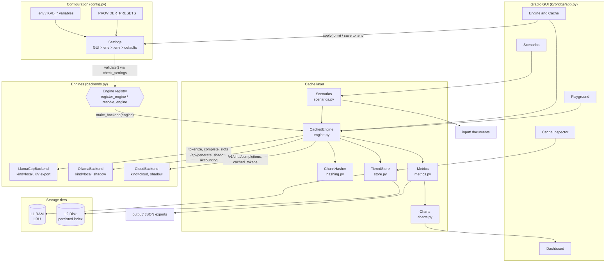
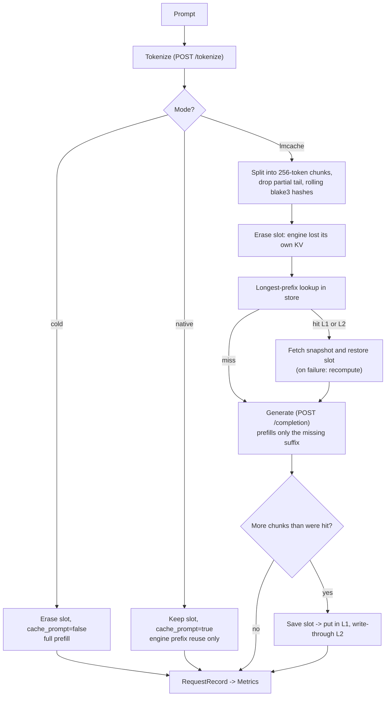
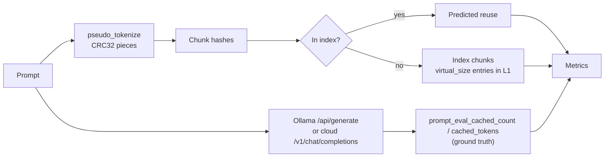
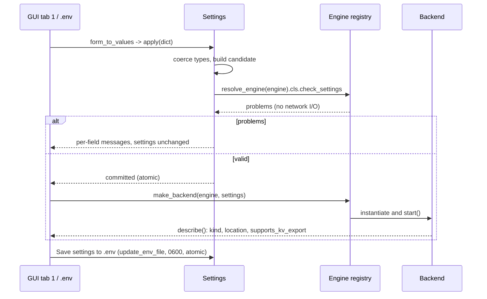

# Architecture

KVBridge puts an LMCache-style KV cache layer between a UI and an inference engine.
The engine is **pluggable**: local (llama.cpp, Ollama) or cloud (any OpenAI-compatible
API), selected and configured in the GUI or in `.env`. No engine setting is hard-coded. Details of the research behind it are in [`Research.md`](Research.md).

## Component flow

## Request pipeline (llama.cpp, full integration)

`cold` and `native` never read or write the store; they exist as baselines.

## Shadow mode (Ollama and cloud)

Ollama and hosted APIs expose no tokenizer and no KV import/export, so the layer cannot move
tensors. Instead it indexes chunk hashes and compares its prediction with the engine's own
report (`prompt_eval_cached_count` for Ollama, `usage.prompt_tokens_details.cached_tokens`
or `prompt_cache_hit_tokens` for cloud):

## Engine registry and configuration flow

* **Registry.** `EngineSpec(name, label, cls, aliases)`; `register_engine` adds one, `resolve_engine` normalises names (`Llama.cpp` = `llamacpp`), `engine_choices()` feeds the GUI Radio. A new engine is one subclass plus one `register_engine` call.
* **Backend contract.** `kind` (`local`/`cloud`), `supports_kv_export`, `describe()`, `check_settings()` classmethod, plus `start/stop/tokenize/generate`. The GUI and scenarios read these flags instead of testing engine names.
* **Priority.** GUI values beat process env, which beats `.env`, which beats defaults. `apply()` is atomic: coercion plus `validate()` run on a candidate copy.
* **Secrets.** `SECRET_FIELDS` are masked by `to_display()`, excluded from `env_values()` by default, redacted from backend error text, and written to `.env` only on explicit request.

### Cloud engine behaviour

* OpenAI-compatible `chat` or `completions` style; the max-tokens field name is configurable.
* Streams the answer to measure TTFT; requests usage in the stream to read `cached_tokens`.
* Retries 429/502/503/504 (3 attempts, honours `Retry-After`).
* `cold` mode prepends a one-shot random nonce so the provider cannot reuse its prefix cache.
* `cloud_token_budget` is a soft cap on prompt tokens per connection; `http://` plus a key is refused for non-loopback hosts.
* Privacy: prompts leave the machine; the status line says so.

## Modules

| Module | Responsibility |
| --- | --- |
| `config.py` | `Settings` from `KVB_*` env vars / `.env` / GUI (`apply`, `validate`, `to_display`, `update_env_file`); provider presets; no hard-coded values |
| `hashing.py` | LMCache-compatible rolling prefix hash; optional adapter to real `TokenHasher` |
| `store.py` | Two-tier snapshot store, LRU, write-through, persistence, resize, eviction counters |
| `backends.py` | Engine registry; `LlamaCppBackend` (slot API), `OllamaBackend` (shadow), `CloudBackend` (OpenAI-compatible, shadow); binary/model discovery |
| `engine.py` | `CachedEngine`: modes `cold`/`native`/`lmcache`, restart simulation, snapshots |
| `metrics.py` | Thread-safe counters, `RequestRecord`, JSON export |
| `scenarios.py` | Document Q&A, multi-turn, shared prefix, restart; reads `input/` recursively |
| `charts.py` | Plotly figures and tables (no Gradio dependency, unit-testable) |
| `app.py` | Gradio Blocks UI generated from the registry; per-engine settings groups; one `AppState` shared by callbacks |

## Design decisions

* **Namespace per model.** Hashes are seeded with `engine|model`, and the store lives in a per-model directory, so snapshots never leak between models.
* **Whole-slot snapshots.** llama.cpp can only serialise a complete slot; an entry is indexed by its chunk-hash chain, so a request sharing the first *k* chunks still hits.
* **Graceful degradation.** A failed restore falls back to full prefill; a failed save is logged and skipped; request errors are recorded on the `RequestRecord` instead of raising into the UI.
* **Locking.** A single `RLock` serialises engine access, because there is one llama.cpp slot.
* **Local GUI.** The GUI binds to `127.0.0.1` and Gradio analytics are disabled. Only the cloud engine sends data off-machine, and only to the URL you configure.
* **Configuration over code.** Engine choice, paths, ports, timeouts, keep-alive and seed are settings, not constants; `.env.example` is tested to list every field.
