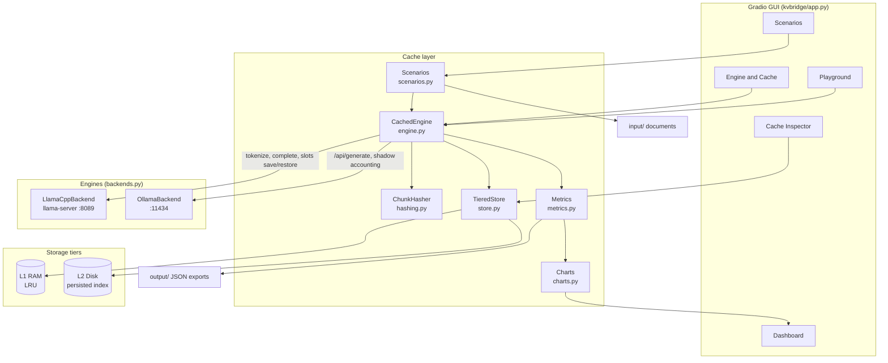
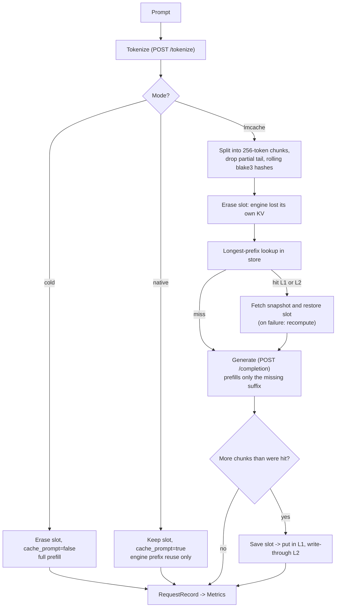
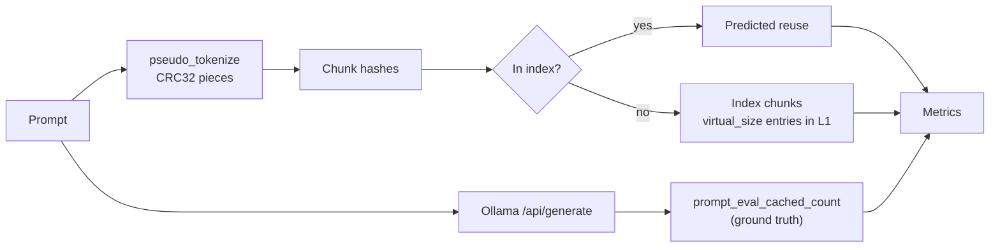

# Architecture

KVBridge puts an LMCache-style KV cache layer between a UI and a local inference
engine. Details of the research behind it are in [`Research.md`](Research.md).

## Component flow

## Request pipeline (llama.cpp, full integration)

`cold` and `native` never read or write the store; they exist as baselines.

## Shadow mode (Ollama)

Ollama exposes no tokenizer and no KV import/export, so the layer cannot move
tensors. Instead:

## Modules

| Module | Responsibility |
| --- | --- |
| `config.py` | `Settings` from `KVB_*` env vars / `.env`; no hard-coded values |
| `hashing.py` | LMCache-compatible rolling prefix hash; optional adapter to real `TokenHasher` |
| `store.py` | Two-tier snapshot store, LRU, write-through, persistence, resize, eviction counters |
| `backends.py` | `LlamaCppBackend` (slot API), `OllamaBackend` (shadow), binary/model discovery |
| `engine.py` | `CachedEngine`: modes `cold`/`native`/`lmcache`, restart simulation, snapshots |
| `metrics.py` | Thread-safe counters, `RequestRecord`, JSON export |
| `scenarios.py` | Document Q&A, multi-turn, shared prefix, restart; reads `input/` recursively |
| `charts.py` | Plotly figures and tables (no Gradio dependency, unit-testable) |
| `app.py` | Gradio Blocks UI; one `AppState` shared by callbacks |

## Design decisions

* **Namespace per model.** Hashes are seeded with `engine|model`, and the store lives in a per-model directory, so snapshots never leak between models.
* **Whole-slot snapshots.** llama.cpp can only serialise a complete slot; an entry is indexed by its chunk-hash chain, so a request sharing the first *k* chunks still hits.
* **Graceful degradation.** A failed restore falls back to full prefill; a failed save is logged and skipped; request errors are recorded on the `RequestRecord` instead of raising into the UI.
* **Locking.** A single `RLock` serialises engine access, because there is one llama.cpp slot.
* **Local only.** Binds to `127.0.0.1`; Gradio analytics are disabled.
