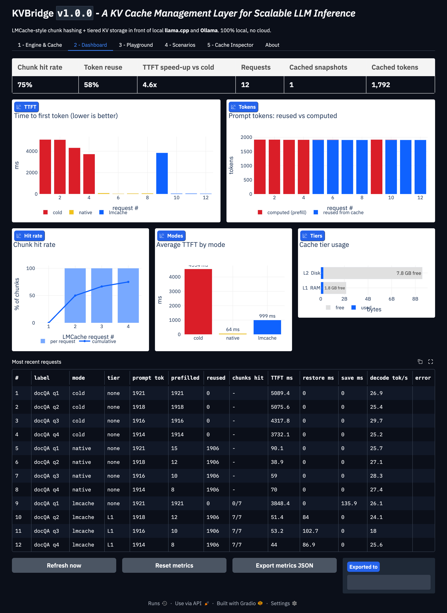
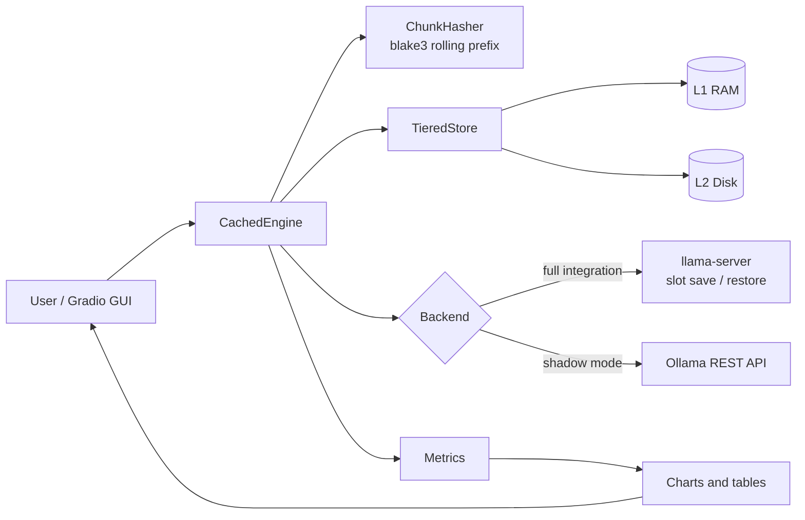
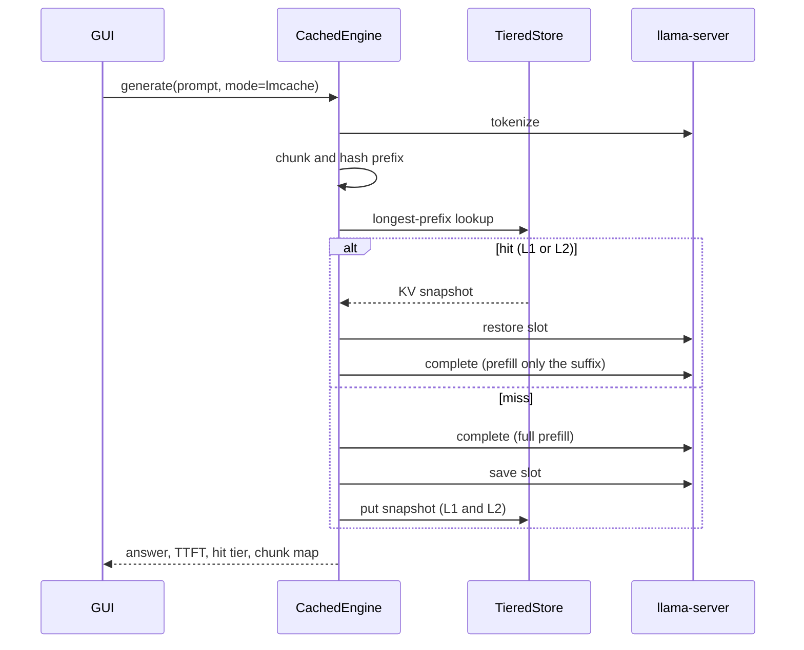

# KVBridge - an LMCache-style KV cache layer for local llama.cpp and Ollama

> *A KV Cache Management Layer for Scalable LLM Inference* - running 100 % locally,
> with a Gradio dashboard that shows hit rates, tier usage, and TTFT gains live.

[LMCache](https://github.com/LMCache/LMCache) officially supports vLLM, SGLang and
TRT-LLM on Linux/CUDA. It has **no** connector for Ollama or llama.cpp, and its
wheel cannot be installed on macOS. KVBridge brings the LMCache *concepts* to
local engines:

* **Chunk-level rolling prefix hashing** (blake3, 256-token chunks, bit-compatible with LMCache's `TokenHasher`)
* **Tiered KV storage**: L1 = RAM, L2 = disk, LRU eviction, persistence across restarts
* **llama.cpp** - *full integration*: real KV tensors are moved with the `llama-server` slot save/restore API
* **Ollama** - *shadow mode*: Ollama hides its KV state, so KVBridge indexes and accounts for chunks and uses Ollama's own `prompt_eval_cached_count` as ground truth
* Three execution modes to prove the value: `cold` vs `native` vs `lmcache`

See [`Docs/Research.md`](Docs/Research.md) for the full feasibility study.



## Measured results

Apple Silicon, llama3.2 3B Q4_K_M, ~1,900-token shared document, 4 questions per mode:

| Mode | Average TTFT | Comment |
| --- | --- | --- |
| cold | 4,554 ms | full prefill every time |
| native | 64 ms | engine slot still warm (best case, volatile) |
| lmcache | 999 ms avg, **44-53 ms** after the first request | 75 % chunk hit rate, persists across restarts |

After an engine restart the L2 (disk) tier restores a ~800-token prefix in **13 ms**
versus 495 ms cold.

## Architecture



## Request workflow



Details: [`Docs/Architecture.md`](Docs/Architecture.md). Full developer documentation (single page, open in a browser): [`Docs/KVBridge_Documentation.html`](Docs/KVBridge_Documentation.html).

## Features (GUI tabs)

| Tab | What it shows |
| --- | --- |
| 1 - Engine & Cache | Choose llama.cpp or Ollama, set chunk size and L1/L2 capacity, connect |
| 2 - Dashboard | KPIs (hit rate, token reuse, speed-up), TTFT / token / hit-rate / tier charts, recent requests, JSON export |
| 3 - Playground | Send your own prompts in cold / native / lmcache mode, with a chunk map |
| 4 - Scenarios | Document Q&A, multi-turn chat, shared system prompt, engine restart |
| 5 - Cache Inspector | Stored snapshots, clear L1 / all, simulate an engine restart, resize tiers |
| About | Research notes |

## Quick start

Requirements: macOS or Linux, [`uv`](https://docs.astral.sh/uv/), Python 3.12, and either
Ollama (with a pulled model) or a `llama-server` binary plus a GGUF model.
Ollama.app ships a `llama-server`, and the Ollama GGUF blob is resolved automatically.

```bash
scripts/setup.sh      # creates .venv with uv, installs requirements, creates .env
scripts/start.sh      # starts the GUI detached and prints its URL
# -> KVBridge is running: http://127.0.0.1:7871
scripts/stop.sh       # graceful shutdown (also stops the managed llama-server)
```

Then open the URL, go to **1 - Engine & Cache**, pick *llama.cpp (full integration)*
and click **Connect**, then run a scenario in **4 - Scenarios**.

More: [`Docs/Quickstart.md`](Docs/Quickstart.md).

## Configuration

Everything is configured through `KVB_*` environment variables or a `.env` file
(copy [`.env.example`](.env.example)). Nothing is hard-coded.

| Variable | Default | Purpose |
| --- | --- | --- |
| `KVB_LLAMA_SERVER_BIN` | auto | Path to `llama-server` |
| `KVB_LLAMA_URL` | empty | Attach to a running llama-server instead of starting one |
| `KVB_OLLAMA_URL` | `http://127.0.0.1:11434` | Ollama endpoint |
| `KVB_OLLAMA_MODEL` | `llama3.2:latest` | Ollama model (also used to find the GGUF) |
| `KVB_MODEL_PATH` | empty | Explicit GGUF file |
| `KVB_MANAGED_HOST` / `KVB_MANAGED_PORT` | `127.0.0.1` / `8089` | Managed llama-server address |
| `KVB_CTX_SIZE` | `8192` | Context window |
| `KVB_N_GPU_LAYERS` | `-1` | GPU offload layers |
| `KVB_CACHE_RAM_MB` | `0` | llama.cpp's own prompt cache (0 keeps the comparison honest) |
| `KVB_EXTRA_ARGS` | empty | Extra llama-server flags |
| `KVB_REQUEST_TIMEOUT` | `300` | HTTP timeout (s) |
| `KVB_CHUNK_SIZE` | `256` | Tokens per chunk (LMCache default) |
| `KVB_L1_MB` / `KVB_L2_MB` | `2048` / `8192` | RAM / disk tier capacity |
| `KVB_WRITE_THROUGH` | `true` | Persist to L2 immediately |
| `KVB_USE_LMCACHE_HASHER` | `false` | Use the real LMCache `TokenHasher` if installed |
| `KVB_STORE_DIR`, `KVB_SLOT_DIR`, `KVB_LOG_DIR`, `KVB_INPUT_DIR`, `KVB_OUTPUT_DIR` | under project | Folders |
| `KVB_N_PREDICT`, `KVB_TEMPERATURE` | `48`, `0.2` | Generation defaults |
| `KVB_GUI_HOST` / `KVB_GUI_PORT` | `127.0.0.1` / `7871` | GUI bind address |

## Usage examples

**Your own documents.** Drop `.txt` / `.md` files into `input/` (scanned recursively).
They are used as the long shared context for the Playground and the scenarios.

**Exports.** *Dashboard -> Export metrics JSON* writes a timestamped file to `output/`.

**Headless / programmatic use:**

```python
from kvbridge.config import Settings
from kvbridge.backends import make_backend
from kvbridge.engine import CachedEngine

settings = Settings.from_env()
engine = CachedEngine(settings, make_backend("llamacpp", settings))
engine.start()                       # starts/attaches llama-server
shared = "...a long document..."
r1 = engine.infer(shared + "\nQ: Summarise it.", mode="lmcache", label="q1")  # miss, saves
r2 = engine.infer(shared + "\nQ: Who wrote it?", mode="lmcache", label="q2")  # hit
print(r1.ttft_ms, r2.ttft_ms, r2.tier, r2.text)
engine.stop()
```

**Tests:**

```bash
scripts/test.sh            # unit tests (no engine needed)
scripts/test.sh --live     # also tests against the real llama.cpp and Ollama
```

## Performance considerations

* A KV snapshot is roughly **0.11 MB per token** for llama3.2 3B (about 70 MB for 600 tokens). Size L1/L2 for the number of distinct prefixes you want to keep.
* Save/restore costs 5-14 ms per ~600 tokens, negligible compared with prefill.
* Smaller `KVB_CHUNK_SIZE` -> finer partial-prefix matches but more hashes; 256 matches LMCache.
* Snapshots are valid only for the same model file and context size. Changing the chunk size invalidates the persisted index (it is ignored with a warning).
* Keep `KVB_CACHE_RAM_MB=0` when benchmarking, otherwise llama.cpp's own cache muddies the comparison.

## Error handling

Connection failures, missing binaries/models, failed slot restores (automatic fallback to a
full prefill), corrupted or mismatched persisted indexes, and timeouts are reported in the GUI
status line and in `output/logs/kvbridge.log` rather than crashing the app.

## Limitations

* This is an LMCache-*style* re-implementation, not LMCache itself, which cannot run with llama.cpp/Ollama or natively on macOS.
* One stored entry is a whole-slot snapshot, not individually shared chunks.
* Ollama runs in shadow mode (accounting only; no KV is moved).
* No remote tiers (Redis/S3) or multi-instance sharing.

## Project layout

```
kvbridge/    config, hashing, metrics, store, backends, engine, scenarios, charts, app
tests/       pytest suite (unit + opt-in live tests)
scripts/     setup, start, stop, cleanup, test, install_lmcache
Docs/        Quickstart, Architecture, Research, KVBridge_Documentation.html
input/       your documents (contents ignored by git)
output/      timestamped exports, logs, cache (contents ignored by git)
```

## Housekeeping

* `scripts/cleanup.sh` removes `.venv`, `node_modules` and `__pycache__`.
* No container images are pulled by this project, so there is no image-cleanup script.

## Licence

Apache License 2.0 (the same licence as LMCache).
