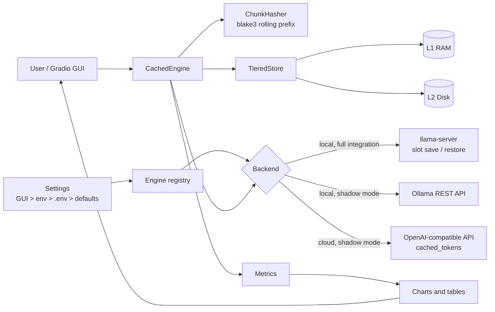
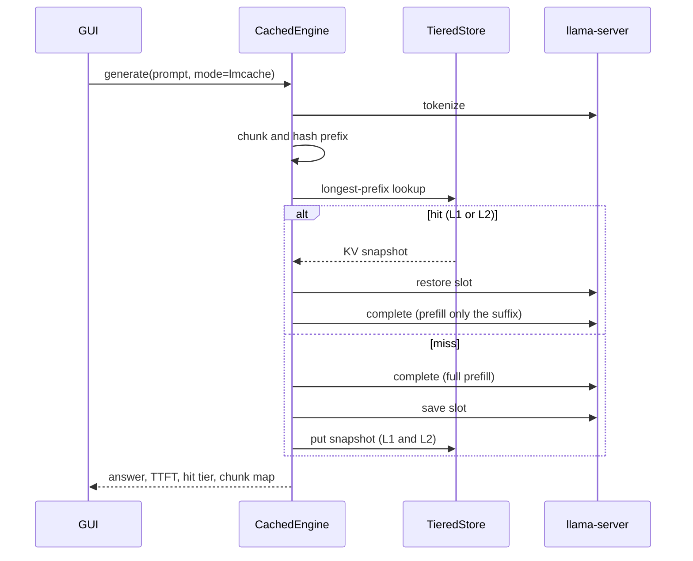

# KVBridge - an LMCache-style KV cache layer for local and cloud LLM engines

> *A KV Cache Management Layer for Scalable LLM Inference* - in front of local engines
> (llama.cpp, Ollama) **or** any OpenAI-compatible cloud service, with a Gradio dashboard
> that shows hit rates, tier usage, and TTFT gains live. The engine is chosen in the GUI
> or in `.env`; nothing is hard-coded.

[LMCache](https://github.com/LMCache/LMCache) officially supports vLLM, SGLang and
TRT-LLM on Linux/CUDA. It has **no** connector for Ollama, llama.cpp or hosted APIs, and its
wheel cannot be installed on macOS. KVBridge brings the LMCache *concepts* to
local and cloud engines through a pluggable engine registry:

* **Chunk-level rolling prefix hashing** (blake3, 256-token chunks, bit-compatible with LMCache's `TokenHasher`)
* **Tiered KV storage**: L1 = RAM, L2 = disk, LRU eviction, persistence across restarts
* **llama.cpp** - *full integration*: real KV tensors are moved with the `llama-server` slot save/restore API
* **Ollama** - *shadow mode*: Ollama hides its KV state, so KVBridge indexes and accounts for chunks and uses Ollama's own `prompt_eval_cached_count` as ground truth
* **Cloud (OpenAI-compatible)** - *shadow mode*: OpenAI, Groq, OpenRouter, Together, Mistral, DeepSeek, vLLM, LM Studio or any `/v1` endpoint. KVBridge accounts for chunks and reads the provider's own `cached_tokens` as ground truth. A token budget protects your bill
* **Engine registry**: engines are plug-ins (`register_engine`); the GUI Radio and the config validation are generated from it
* Three execution modes to prove the value: `cold` vs `native` vs `lmcache`

See [`Docs/Research.md`](Docs/Research.md) for the full feasibility study.


## Measured results

Apple Silicon, llama3.2 3B Q4_K_M, ~1,900-token shared document, 4 questions per mode:

| Mode | Average TTFT | Comment |
| --- | --- | --- |
| cold | 4,554 ms | full prefill every time |
| native | 64 ms | engine slot still warm (best case, volatile) |
| lmcache | 999 ms avg, **44-53 ms** after the first request | 75 % chunk hit rate, persists across restarts |

After an engine restart the L2 (disk) tier restores a ~800-token prefix in **13 ms**
versus 495 ms cold.

## Architecture



## Request workflow



Details: [`Docs/Architecture.md`](Docs/Architecture.md). Full developer documentation (single page, open in a browser): [`Docs/KVBridge_Documentation.html`](Docs/KVBridge_Documentation.html).

## Features (GUI tabs)

| Tab | What it shows |
| --- | --- |
| 1 - Engine & Cache | Choose the engine (llama.cpp, Ollama, Cloud), edit every engine setting (provider preset, URL, model, API key, budget...), set chunk size and L1/L2 capacity, connect, show the masked effective configuration, save to `.env` |
| 2 - Dashboard | KPIs (hit rate, token reuse, speed-up), TTFT / token / hit-rate / tier charts, recent requests, JSON export |
| 3 - Playground | Send your own prompts in cold / native / lmcache mode, with a chunk map |
| 4 - Scenarios | Document Q&A, multi-turn chat, shared system prompt, engine restart |
| 5 - Cache Inspector | Stored snapshots, clear L1 / all, simulate an engine restart, resize tiers |
| About | Research notes |

## Quick start

Requirements: macOS or Linux, [`uv`](https://docs.astral.sh/uv/), Python 3.12, and **one** of:

* a `llama-server` binary plus a GGUF model (Ollama.app ships a `llama-server`, and the Ollama GGUF blob is resolved automatically),
* a running Ollama with a pulled model,
* an OpenAI-compatible cloud endpoint and an API key.

```bash
scripts/setup.sh      # creates .venv with uv, installs requirements, creates .env
scripts/start.sh      # starts the GUI detached and prints its URL
# -> KVBridge is running: http://127.0.0.1:7871
scripts/stop.sh       # graceful shutdown (also stops the managed llama-server)
```

Then open the URL, go to **1 - Engine & Cache**, pick an engine, adjust its settings and click
**Connect**, then run a scenario in **4 - Scenarios**. Choose the engine in `.env` instead by
setting `KVB_ENGINE` (see below).

More: [`Docs/Quickstart.md`](Docs/Quickstart.md).

## Configuration

Every engine setting is configurable from the **GUI** or from `KVB_*` **environment variables /
`.env`** (copy [`.env.example`](.env.example), which documents every variable). Nothing is
hard-coded. Precedence, highest first:

1. values entered in the GUI (this session; **Save settings to .env** persists them),
2. process environment variables,
3. the `.env` file,
4. built-in defaults.

### Engine selection

| Variable | Default | Purpose |
| --- | --- | --- |
| `KVB_ENGINE` | `llamacpp` | `llamacpp` (alias `llama`), `ollama`, or `cloud` (aliases `openai`, `api`) |

### llama.cpp (local, full integration)

| Variable | Default | Purpose |
| --- | --- | --- |
| `KVB_LLAMA_SERVER_BIN` | auto | Path to `llama-server` |
| `KVB_LLAMA_SEARCH_PATHS` | built-in list | Extra directories searched for `llama-server` (path-separated) |
| `KVB_LLAMA_URL` | empty | Attach to a running llama-server instead of starting one |
| `KVB_LLAMA_START_TIMEOUT` | `180` | Seconds to wait for the managed server |
| `KVB_MODEL_PATH` | empty | Explicit GGUF file |
| `KVB_MANAGED_HOST` / `KVB_MANAGED_PORT` | `127.0.0.1` / `8089` | Managed llama-server address |
| `KVB_RESERVED_PORTS` | `5000,8080,9931,11434` | Ports the managed server must not use |
| `KVB_N_GPU_LAYERS` | `-1` | GPU offload layers |
| `KVB_CACHE_RAM_MB` | `0` | llama.cpp's own prompt cache (0 keeps the comparison honest) |
| `KVB_EXTRA_ARGS` | empty | Extra llama-server flags |

### Ollama (local, shadow mode)

| Variable | Default | Purpose |
| --- | --- | --- |
| `KVB_OLLAMA_URL` | `http://127.0.0.1:11434` | Ollama endpoint |
| `KVB_OLLAMA_MODEL` | `llama3.2:latest` | Model name |
| `KVB_OLLAMA_KEEP_ALIVE` | `10m` | How long Ollama keeps the model loaded |
| `KVB_OLLAMA_MODELS_DIR` | empty | Override the Ollama models directory |

### Cloud (OpenAI-compatible, shadow mode)

| Variable | Default | Purpose |
| --- | --- | --- |
| `KVB_CLOUD_PROVIDER` | empty | Preset: `openai`, `groq`, `openrouter`, `together`, `mistral`, `deepseek`, `vllm-local`, `lmstudio-local`, `ollama-local-openai` |
| `KVB_CLOUD_BASE_URL` | from preset | OpenAI-compatible base URL (usually ends in `/v1`) |
| `KVB_CLOUD_MODEL` | empty | Model id |
| `KVB_CLOUD_API_KEY` | empty | API key (prefer the next variable) |
| `KVB_CLOUD_API_KEY_ENV` | empty | **Name** of an environment variable that holds the key |
| `KVB_CLOUD_EXTRA_HEADERS` | empty | JSON object of extra HTTP headers |
| `KVB_CLOUD_API_STYLE` | `chat` | `chat` (`/chat/completions`) or `completions` |
| `KVB_CLOUD_MAX_TOKENS_FIELD` | `max_tokens` | e.g. `max_completion_tokens` for newer OpenAI models |
| `KVB_CLOUD_SEND_TEMPERATURE` | `true` | Disable for models that reject `temperature` |
| `KVB_CLOUD_STREAM_USAGE` | `true` | Ask for usage (and `cached_tokens`) in the stream |
| `KVB_CLOUD_VERIFY_TLS` | `true` | Verify TLS certificates |
| `KVB_CLOUD_KV_BYTES_PER_TOKEN` | `0` | Estimate used for memory accounting (0 = unknown) |
| `KVB_CLOUD_TOKEN_BUDGET` | `0` | Soft cap on prompt tokens sent per connection (0 = unlimited) |

### Shared, cache and GUI

| Variable | Default | Purpose |
| --- | --- | --- |
| `KVB_CTX_SIZE` | `8192` | Context window |
| `KVB_REQUEST_TIMEOUT` | `300` | HTTP timeout (s) |
| `KVB_SEED` | `1` | Sampling seed |
| `KVB_CHUNK_SIZE` | `256` | Tokens per chunk (LMCache default) |
| `KVB_L1_MB` / `KVB_L2_MB` | `2048` / `8192` | RAM / disk tier capacity |
| `KVB_WRITE_THROUGH` | `true` | Persist to L2 immediately |
| `KVB_USE_LMCACHE_HASHER` | `false` | Use the real LMCache `TokenHasher` if installed |
| `KVB_STORE_DIR`, `KVB_SLOT_DIR`, `KVB_LOG_DIR`, `KVB_INPUT_DIR`, `KVB_OUTPUT_DIR` | under project | Folders |
| `KVB_N_PREDICT`, `KVB_TEMPERATURE` | `48`, `0.2` | Generation defaults |
| `KVB_GUI_HOST` / `KVB_GUI_PORT` | `127.0.0.1` / `7871` | GUI bind address |

### `.env` examples

```bash
# Local, full integration (llama.cpp)
KVB_ENGINE=llamacpp
KVB_OLLAMA_MODEL=llama3.2:latest        # used to locate the GGUF blob
KVB_CTX_SIZE=8192

# Local, shadow mode (Ollama)
KVB_ENGINE=ollama
KVB_OLLAMA_URL=http://127.0.0.1:11434
KVB_OLLAMA_MODEL=llama3.2:latest

# Hosted provider; the key stays in your shell, not in .env
KVB_ENGINE=cloud
KVB_CLOUD_PROVIDER=openai
KVB_CLOUD_MODEL=gpt-4o-mini
KVB_CLOUD_API_KEY_ENV=OPENAI_API_KEY    # export OPENAI_API_KEY=... first
KVB_CLOUD_TOKEN_BUDGET=200000

# Free smoke test of the cloud path against Ollama's OpenAI-compatible API
KVB_ENGINE=cloud
KVB_CLOUD_PROVIDER=ollama-local-openai
KVB_CLOUD_MODEL=llama3.2:latest
```

### Secrets

API keys are never logged, exported to `output/`, or shown in the GUI (the key box is a
password field that is never pre-filled; blank means "keep the current key"). **Show effective
configuration** masks them. **Save settings to .env** writes the key only if you tick
*Also write the API key*; the file is written atomically with mode `0600`, and `.env` is
git-ignored. Plain `http://` with an API key is refused for non-loopback hosts.

## Usage examples

**Local, full integration (llama.cpp).** `KVB_ENGINE=llamacpp`, Connect, run *Document Q&A*:
the first question prefills, later ones restore the stored KV and show TTFT in tens of ms.

**Local, shadow mode (Ollama).** `KVB_ENGINE=ollama`: KVBridge tracks chunk hits and compares
them to Ollama's `prompt_eval_cached_count`.

**Hosted provider with a budget.** Pick *Cloud*, choose a preset, enter the model, give the
key (box or env-var name), set a token budget, Connect. Run *Shared system prompt*: the dashboard
shows the provider-reported `cached_tokens`. Providers cache only prompts above their minimum
length (e.g. 1,024 tokens on OpenAI) and for a limited time, so use a long shared prefix.

**Free smoke test of the cloud path.** Preset `ollama-local-openai`, model `llama3.2:latest`.

**Change engines without editing files.** Edit any field in the GUI, Connect, then
**Save settings to .env** to keep it.

**Your own documents.** Drop `.txt` / `.md` files into `input/` (scanned recursively).
They are used as the long shared context for the Playground and the scenarios.

**Exports.** *Dashboard -> Export metrics JSON* writes a timestamped file to `output/`.

**Headless / programmatic use:**

```python
from kvbridge.config import Settings
from kvbridge.backends import make_backend
from kvbridge.engine import CachedEngine

settings = Settings.from_env()               # honours KVB_ENGINE and .env
problems = settings.validate()               # per-engine checks, no network I/O
assert not problems, problems
engine = CachedEngine(settings, make_backend(settings.engine, settings))
engine.start()                               # starts/attaches/connects
shared = "...a long document..."
r1 = engine.infer(shared + "\nQ: Summarise it.", mode="lmcache", label="q1")  # miss, saves
r2 = engine.infer(shared + "\nQ: Who wrote it?", mode="lmcache", label="q2")  # hit
print(r1.ttft_ms, r2.ttft_ms, r2.tier, r2.text)
engine.stop()
```

**Tests** (188 tests; 5 skipped when LMCache or live engines are absent):

```bash
scripts/test.sh            # unit tests (no engine needed; cloud is faked)
scripts/test.sh --live     # also tests against the real llama.cpp, Ollama and the cloud path
```

## Performance considerations

* A KV snapshot is roughly **0.11 MB per token** for llama3.2 3B (about 70 MB for 600 tokens). Size L1/L2 for the number of distinct prefixes you want to keep.
* Save/restore costs 5-14 ms per ~600 tokens, negligible compared with prefill.
* Smaller `KVB_CHUNK_SIZE` -> finer partial-prefix matches but more hashes; 256 matches LMCache.
* Snapshots are valid only for the same model file and context size. Changing the chunk size invalidates the persisted index (it is ignored with a warning).
* Keep `KVB_CACHE_RAM_MB=0` when benchmarking, otherwise llama.cpp's own cache muddies the comparison.

## Error handling

Connection failures, invalid settings (reported per field before connecting), cloud HTTP errors (429/5xx are retried with `Retry-After`; API keys are redacted from every message), missing binaries/models, failed slot restores (automatic fallback to a
full prefill), corrupted or mismatched persisted indexes, and timeouts are reported in the GUI
status line and in `output/logs/kvbridge.log` rather than crashing the app.

## Limitations

* This is an LMCache-*style* re-implementation, not LMCache itself, which cannot run with llama.cpp/Ollama or natively on macOS.
* One stored entry is a whole-slot snapshot, not individually shared chunks.
* Ollama and cloud engines run in shadow mode (accounting only; no KV is moved). Hosted APIs never expose KV tensors, so KVBridge cannot store or restore them.
* Cloud: prompts **leave your machine**, and billing, rate limits and the provider's own cache TTL/thresholds apply. `cold` mode prepends a random nonce so the provider cannot reuse its cache.
* No remote tiers (Redis/S3) or multi-instance sharing.

## Project layout

```
kvbridge/    config, hashing, metrics, store, backends (engine registry), engine, scenarios, charts, app
tests/       pytest suite (unit + opt-in live tests)
scripts/     setup, start, stop, cleanup, test, install_lmcache
Docs/        Quickstart, Architecture, Research, KVBridge_Documentation.html
input/       your documents (contents ignored by git)
output/      timestamped exports, logs, cache (contents ignored by git)
```

## Housekeeping

* `scripts/cleanup.sh` removes `.venv`, `node_modules` and `__pycache__`.
* No container images are pulled by this project, so there is no image-cleanup script.

## Licence

Apache License 2.0 (the same licence as LMCache).
